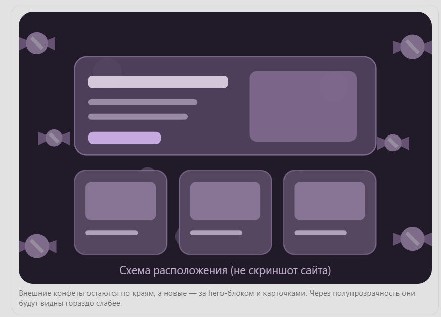

# AEGIS COSPLAY — контрольная работа №3

**Дисциплина:** Фронтенд и бэкенд разработка  
**Тема:** «Адаптивная вёрстка и доступность многостраничного HTML/CSS-сайта».  
**Проект:** AEGIS COSPLAY — учебный интернет-магазин косплей-костюмов и аксессуаров.

## Автор

**ФИО:** Сутормина Виктория  
**Группа:** ЭФБО-06-25

Проект выполнен на основе HTML/CSS-сайта из контрольной работы №1. Для адаптивной вёрстки используются собственные стили, CSS Grid, Flexbox и медиазапросы. Bootstrap и другие CSS-фреймворки не используются.

JavaScript применяется для работы с существующими формами заказа и модальным окном. Серверная обработка заказов и обратной связи не реализована: это учебная демонстрация интерфейса.

## Ссылка на репозиторий

https://github.com/Vikki122222/kr3-responsive-shop

## Страницы сайта

- `index.html` — главная страница, hero-блок, преимущества, популярные костюмы и декоративная анимация конфет.
- `catalog.html` — каталог товаров, фильтры и адаптивная сетка карточек.
- `product.html` — подробная страница костюма Афины и таблица характеристик.
- `order.html` — страница оформления заказа с адаптивной формой.
- `contacts.html` — контактная информация, описание магазина и форма обратной связи.

## Практическое занятие №12 — адаптивная вёрстка

В ходе практического занятия подготовлен отдельный репозиторий `kr3-responsive-shop` на основе проекта КР №1.

Основные решения:

- На всех страницах добавлен `viewport`.
- После `css/style.css` подключён отдельный файл `css/responsive.css`.
- Использован подход Mobile First.
- Добавлены медиазапросы для мобильных, планшетных и компьютерных экранов.
- Навигация адаптирована под разную ширину экрана.
- Hero-блок перестраивается из одной колонки в две.
- Карточки товаров размещаются с помощью CSS Grid.
- Фильтры каталога на мобильных экранах располагаются перед товарами, а на больших — сбоку.
- Форма заказа перестраивается из одной колонки в две.
- Таблица характеристик размещена внутри `.table-wrapper` с собственной горизонтальной прокруткой.
- Изображения ограничены шириной контейнера и не выходят за его пределы.
- Для изображений на соответствующих страницах используются `picture`, `srcset`, `sizes` и `loading="lazy"`.

### Применённые технологии

**Flexbox:** меню, кнопки, содержимое карточек товаров, расположение подвала.

**CSS Grid:** hero-блок, каталог, карточки товаров, страница товара и формы.

**Медиазапросы:** адаптация расположения блоков и размеров элементов.

**Responsive images:** выбор подходящих изображений в зависимости от ширины экрана.

### Адаптация по ширине

- Менее 640 px — карточки товаров располагаются в одну колонку.
- От 640 px — карточки располагаются в две колонки.
- От 768 px — навигация становится горизонтальной, а форма заказа может использовать две колонки.
- От 900 px — hero-блок делится на текстовую часть и изображение.
- От 1024 px — на главной странице карточки располагаются в три колонки, а фильтры каталога перемещаются в боковую панель.
- От 1024 до 1299 px — каталог использует две колонки карточек.
- От 1300 px — каталог использует три колонки карточек.

Количество колонок выбрано с учётом ширины карточек и читаемости описаний товаров.

## Практическое занятие №13 — доступность и Lighthouse

В рамках практики выполнены исправления доступности интерфейса.

### Семантическая структура

Используются HTML-элементы:

- `header` — шапка сайта;
- `nav` — навигация;
- `main` — основное содержимое;
- `section` — смысловые разделы;
- `article` — карточки товаров;
- `aside` — дополнительная информация;
- `footer` — подвал.

На каждой странице предусмотрен один основной заголовок `h1`.

### Клавиатурная доступность

- Добавлена ссылка `skip-link` для перехода сразу к основному содержимому.
- Основной контейнер имеет `id="main"`.
- Для интерактивных элементов добавлен видимый фокус `:focus-visible`.
- Текущая страница меню обозначается через `aria-current="page"`.
- Модальное окно заказа можно закрыть клавишей Escape.
- После закрытия модального окна фокус возвращается на кнопку, с которой оно было открыто.

### Формы и изображения

- Поля форм имеют подписи `label`.
- Для обязательных полей используется `required`.
- Применяются типы полей `email`, `tel`, `date`.
- Для проверки телефона используется `pattern`.
- Некорректно заполненные поля могут получать `aria-invalid="true"`.
- Сообщения о результате заполнения формы используют `role="status"`.
- Изображения имеют осмысленные описания `alt`.
- У таблицы характеристик есть `caption`, а заголовки содержат `scope`.

### Результаты Lighthouse Accessibility

Во время практического занятия №13 были получены следующие результаты:

| Страница | Результат практики №13 | HTML-отчёт |
| --- | --- | --- |
| `index.html` | **100/100** | `lighthouse/accessibility-report.html` |
| `catalog.html` | **100/100** | `lighthouse/catalog-accessibility.html` |
| `order.html` | **100/100** | `lighthouse/order-accessibility.html` |

**Финальная проверка:** 03.11.2026 после изменения дизайна повторно сохранены три HTML-отчёта в папке `lighthouse/`. Таблица выше фиксирует результаты *практики №13*; оценку повторной проверки следует смотреть непосредственно в актуальных HTML-отчётах, поскольку новый балл здесь отдельно не указан.

Автоматическая проверка дополняется ручной проверкой клавиатуры, форм и модального окна.

## Практическое занятие №14 — финальная подготовка КР №3

В рамках подготовки проекта к сдаче:

- Проверены пять обязательных HTML-страниц и подключение стилей.
- Проверена адаптация навигации, hero-блока, каталога, изображений, таблицы и форм.
- Проверена работа модального окна заказа.
- Добавлены комментарии к HTML, CSS и JavaScript с пояснением решений практик №12 и №13.
- Доработан визуальный стиль, добавлена анимация конфет и форма обратной связи.
- Обновлён основной `README.md` и сохранены отчёты Lighthouse.
- Финальные изменения подготавливаются к Pull Request в ветку `main`.

## Дополнительное оформление AEGIS COSPLAY

После выполнения основных требований доработан визуальный стиль магазина.

### Полупрозрачные панели

В оформлении используются:

- тёмно-фиолетовая цветовая палитра;
- полупрозрачные блоки с эффектом матового стекла;
- мягкие границы и скругления;
- увеличенные заголовки и основной текст;
- более широкие контейнеры;
- увеличенные карточки товаров;
- плавная подсветка карточек при наведении.

Основные цветовые значения и размеры задаются через CSS-переменные. Базовые стили находятся в `css/style.css`, а адаптивность и дополнительные визуальные эффекты — в `css/responsive.css`.

### Дизайн и анимация конфет на главной странице

Для оформления главной страницы добавлены **12 декоративных конфет**: шесть расположены ближе к краям экрана, а ещё шесть — ближе к центральной части, визуально за полупрозрачными панелями hero-блока и карточек товаров. Центральные конфеты менее яркие и двигаются медленнее, поэтому не мешают чтению текста.

**Схема расположения конфет:**



*Это схема расположения элементов, а не скриншот работающего сайта. Картинка добавлена для пояснения визуальной идеи.*

#### В каких файлах реализованы конфеты

**`index.html` — HTML-разметка декоративного слоя.**

После ссылки `skip-link` внутри `body` добавлен контейнер `.floating-candies`, содержащий 12 элементов `span` с классами `.floating-candy--1` … `.floating-candy--12`.

```html
<div class="floating-candies" aria-hidden="true">
    <span class="floating-candy floating-candy--1"></span>
    <!-- Остальные конфеты с номерами от 2 до 11 -->
    <span class="floating-candy floating-candy--12"></span>
</div>
```

Контейнер расположен **только в `index.html`**, поэтому конфет нет на страницах каталога, товара, заказа и контактов. Атрибут `aria-hidden="true"` скрывает чисто декоративные элементы от экранных дикторов.

**`css/responsive.css` — внешний вид, движение и адаптивность.**

- Класс `.floating-candies` создаёт отдельный слой с `position: fixed`, охватывающий окно браузера.
- `pointer-events: none` не позволяет декору перехватывать нажатия мыши и касания.
- У конфет используются `border-radius`, CSS-градиенты, прозрачность и тени; отдельные картинки конфет для анимации не нужны.
- Псевдоэлементы `::before` и `::after` формируют боковые части фантиков.
- Классы `.floating-candy--1` … `.floating-candy--12` задают индивидуальные размеры, положение, прозрачность, длительность и задержку анимации.
- `@keyframes candyFloat` создаёт медленное покачивание и небольшое перемещение вверх и в стороны.
- Слои настроены через `z-index`: декоративный контейнер находится ниже `main`, а содержимое сайта остаётся поверх него. Полупрозрачные фоны `rgba(...)` и `backdrop-filter` создают эффект глубины.
- При ширине **менее 1024 px** конфеты скрыты, чтобы не загромождать мобильную вёрстку.
- При ширине **от 1024 до 1199 px** две центральные конфеты дополнительно скрываются, а на более широких экранах могут отображаться все 12.
- В `@media (prefers-reduced-motion: reduce)` анимация отключается для пользователей, предпочитающих меньше движения.

**`css/style.css` — базовая основа оформления.**

В этом файле находятся исходные переменные и стили элементов сайта. Обновлённые полупрозрачные панели и слой конфет оформляются в `css/responsive.css`, подключённом после основного файла.

**`js/main.js` — без изменений ради конфет.**

Для декоративной анимации JavaScript не нужен: всё движение выполняется с помощью CSS. Существующие обработчики заказа и модального окна работают отдельно от украшений.

**`images/candy-layout.png` — схема дизайна в README.**

Это изображение используется **только в документации**, чтобы показать расположение конфет относительно панелей. Реальные конфеты на странице создаются HTML и CSS, а не этой картинкой.

### Расположение подвала

Для коротких страниц используется Flexbox, который прижимает подвал к нижней части окна. При этом подвал не фиксируется поверх страницы и не перекрывает содержимое при прокрутке.

Стили находятся в `css/style.css` и `css/responsive.css`.

### Форма обратной связи

На `contacts.html` добавлена учебная форма обратной связи. Форма включает:

- имя;
- электронную почту;
- тему обращения;
- текст сообщения;
- согласие на обработку данных;
- кнопку отправки.

Поля имеют связанные подписи и стандартную HTML-валидацию. Форма адаптируется под мобильные устройства и использует существующие классы оформления из CSS.

В `contacts.html` также размещён небольшой JavaScript-обработчик: он предотвращает обычную отправку формы и выводит поясняющее сообщение. **Данные на сервер не отправляются.**

## Проверка адаптивности

Проведена ручная проверка пяти HTML-страниц на ширинах, предусмотренных методическими указаниями:

**360 px, 430 px, 768 px, 1024 px, 1440 px.**

Проверялись:

- шапка и навигация;
- hero-блок;
- сетка карточек;
- каталог и боковой фильтр;
- страница товара и таблица характеристик;
- страница заказа и форма обратной связи;
- подвал и модальное окно;
- отображение декоративных конфет на больших экранах.

Горизонтальная прокрутка всей страницы недопустима. Для широкой таблицы характеристик предусмотрена отдельная прокрутка внутри `.table-wrapper`.

## Структура проекта

```text
kr3-responsive-shop/
├── index.html
├── catalog.html
├── product.html
├── order.html
├── contacts.html
├── css/
│   ├── style.css
│   └── responsive.css
├── js/
│   └── main.js
├── images/
│   └── candy-layout.png       # Схема декоративных конфет для README
├── lighthouse/
│   ├── accessibility-report.html
│   ├── catalog-accessibility.html
│   ├── order-accessibility.html
│   └── README.md
├── README.md
└── .gitignore
```

В папке `../../Downloads/AEGIS_COSPLAY_README_%D0%B8_%D1%81%D1%85%D0%B5%D0%BC%D0%B0/images` также находятся исходные изображения костюмов. Папка `images/` существовала ранее; для схемы добавлен только один PNG-файл.

## Запуск проекта

Сайт можно открыть непосредственно через файл `index.html`.

Для запуска через локальный сервер необходимо перейти в папку проекта и выполнить:

```bash
python -m http.server 8000
```

После запуска открыть в браузере: http://localhost:8000/index.html

Для проверки адаптивности можно использовать Chrome DevTools → Device Toolbar.

Для проверки доступности используется Chrome DevTools → Lighthouse → Accessibility.

## История практических занятий и Git

### Практическое занятие №12

Ветка: `feature/responsive-layout`  
Pull Request №1: изменения объединены с `main`.

### Практическое занятие №13

Ветка: `feature/a11y-lighthouse-audit`  
Pull Request №2: изменения доступности и Lighthouse-отчёты объединены с `main`.

### Практическое занятие №14

Ветка: `fix/kr3-final-check`

В этой ветке подготавливаются финальные исправления дизайна, документации и проверки проекта. После завершения проверок создаётся Pull Request в основную ветку `main`.
